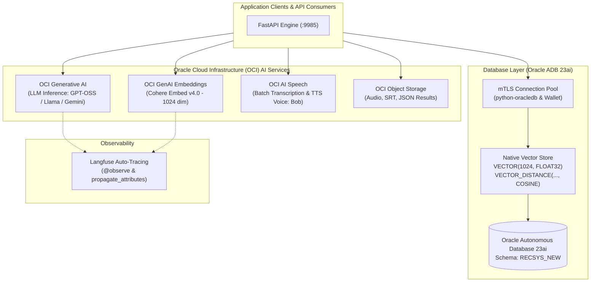

# EnterpriseAI-recsys

> **Enterprise Oracle Cloud AI, OCI AI Speech & Oracle Autonomous Database 23ai Vector Engine**  
> Built with **Oracle Cloud Infrastructure (OCI) Generative AI**, **Oracle Autonomous Database (ADB 23ai)**, **OCI AI Speech**, **FastAPI**, and **Langfuse Observability**.  
> **Author:** Abdallah AlNsour (*Oracle ACE Apprentice*, *OCI Certified Enterprise AI Professional*, *Agentic AI for Oracle AI Database Certified Professional*)

---

## 📖 Overview

**EnterpriseAI-recsys** is a reference architecture and production-grade engine demonstrating how to build end-to-end enterprise AI applications natively on Oracle Cloud. 

This repository extracts the core artificial intelligence capabilities developed in the RecSys platform into a clean, reusable architecture—demonstrating:
1. **OCI Generative AI Inference:** Multi-model dialogue orchestration with specialized **Model Adapters** (isolating quirks for `openai.gpt-oss-120b`, `meta.llama-3.1-70b-instruct`, and `google.gemini-2.5-pro`).
2. **Dense Vector Embeddings:** High-throughput 1024-dimension vector embedding generation using `cohere.embed-v4.0` via `oci.generative_ai_inference`.
3. **Oracle Autonomous Database 23ai Native AI Vector Search:** In-database semantic similarity search utilizing native `VECTOR` columns and `VECTOR_DISTANCE(..., COSINE)`.
4. **OCI AI Speech & Object Storage:** Asynchronous batch audio transcriptions (Speech-to-Text) and dynamic speech synthesis (Text-to-Speech) using `TtsOracleTts1StandardModelDetails` (Voice ID: "Bob").
5. **Full Observability:** Zero-boilerplate automated token, latency, and session tracing via **Langfuse** (`langfuse.openai`).

---

## 🏗️ Architecture Diagram



---

## 🛠️ Key Components & Implementation Highlights

### 1. Unified LLM Manager & Model Adapters (`components/llm_manager/`)
Rather than coupling business code to a single LLM provider, `LLMManager` utilizes the **Model Adapter Pattern**:
* **`DefaultModelAdapter`**: Handles native OCI Generative AI conversation sessions for Google Gemini, Meta Llama, and Cohere Command.
* **`GptOssAdapter`**: Isolates upstream conversation quirks for `openai.gpt-oss-120b`, replaying clean message turns and enforcing reasoning token limits.

### 2. Native Oracle Database 23ai Vector Search (`components/db_manager.py`)
Vector similarity search is executed **directly inside Oracle Database 23ai**:
```sql
SELECT DOC_ID, TITLE, CONTENT,
       VECTOR_DISTANCE(DOC_EMBEDDING, :1, COSINE) AS distance
FROM RECSYS_NEW.ENTERPRISE_DOCUMENTS_VECTOR
ORDER BY distance ASC
FETCH FIRST 5 ROWS ONLY;
```
* **Critical Python Binding Optimization:** Python lists are converted to native C-level float arrays via `array.array('f', embedding)` in `db_manager._sanitize_bind()`, eliminating `ORA-01484` and achieving sub-10ms similarity queries.

### 3. OCI AI Speech & Audio Synthesis (`components/ai_manager.py`)
* **Batch Speech-to-Text:** Submits audio files located in OCI Object Storage to `create_transcription_job()`, extracting timestamped SRT and JSON text transcripts.
* **Text-to-Speech (TTS):** Synthesizes interview questions or alerts dynamically into MP3 audio streams using `TtsOracleTts1StandardModelDetails` (Voice: "Bob") and uploads the resulting audio directly into OCI Object Storage.

---

## 📂 Project Structure

```
EnterpriseAI-recsys/
├── .env.example                  # Environment configuration template
├── .gitignore                    # Security filters for wallets and keys
├── requirements.txt              # Production Python dependencies
├── main.py                       # FastAPI application entrypoint
├── core/
│   ├── config.py                 # Zero-defaults configuration manager
│   └── logger.py                 # Structured correlation logging
├── components/
│   ├── ai_manager.py             # OCI AI Speech (STT/TTS) & Object Storage
│   ├── db_manager.py             # Pooled Oracle DB 23ai with Vector array binding
│   └── llm_manager/              # Unified LLM & Cohere vector manager
│       ├── __init__.py
│       ├── manager.py            # OCI GenAI + Langfuse auto-tracing
│       └── adapters/             # Isolated Model Adapters (Default vs GPT-OSS)
│           ├── __init__.py
│           ├── base.py
│           ├── default.py
│           └── gpt_oss.py
├── schemas/
│   └── ai_schemas.py             # Pydantic request & response models
└── scripts/
    ├── setup_vector_table.sql    # Oracle 23ai Vector table DDL & HNSW index
    └── demo_vector_pipeline.py   # Standalone runnable vector matching demo
```

---

## ⚡ Quick Start

### 1. Prerequisites
- Python 3.10+
- An Oracle Cloud Infrastructure (OCI) tenancy with Generative AI enabled
- An Oracle Autonomous Database (ADB 23ai) instance

### 2. Installation
```bash
# Clone the repository
git clone https://github.com/abdnsour/EnterpriseAI-recsys.git
cd EnterpriseAI-recsys

# Create and activate virtual environment
python -m venv venv
# On Windows:
venv\Scripts\activate
# On Linux/macOS:
source venv/bin/activate

# Install dependencies
pip install -r requirements.txt
```

### 3. Configuration
Copy `.env.example` to `.env` and fill in your Oracle Cloud and database credentials:
```bash
cp .env.example .env
```
*(If using mTLS, place your extracted Oracle Wallet files in `Wallet_CLOUDEX/`)*

### 4. Running the Server
```bash
python main.py
```
* **API Documentation (Swagger UI):** `http://localhost:9985/docs`
* **Health Endpoint:** `http://localhost:9985/health`

---

## 🧪 Testing the Endpoints

### 1. Dense Vector Embeddings (Cohere Embed v4)
```bash
curl -X POST http://localhost:9985/api/ai/embed \
  -H "Content-Type: application/json" \
  -d '{"texts": ["Oracle 23ai AI Vector Search", "OCI Generative AI"]}'
```

### 2. Conversational Reasoning
```bash
curl -X POST http://localhost:9985/api/ai/chat \
  -H "Content-Type: application/json" \
  -d '{"prompt": "Explain how native vector search works in Oracle Database 23ai"}'
```

### 3. In-Database Vector Search
```bash
curl -X POST http://localhost:9985/api/ai/vector-match \
  -H "Content-Type: application/json" \
  -d '{"query": "cloud infrastructure database", "top_k": 3}'
```

---

## 👤 Author
* **Abdallah AlNsour**
* Oracle ACE Apprentice
* OCI Certified Enterprise AI Professional
* Agentic AI for Oracle AI Database Certified Professional
* GitHub: [@abdnsour](https://github.com/abdnsour)
